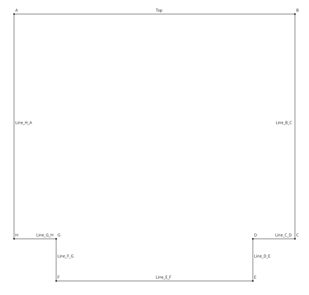
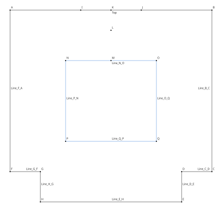
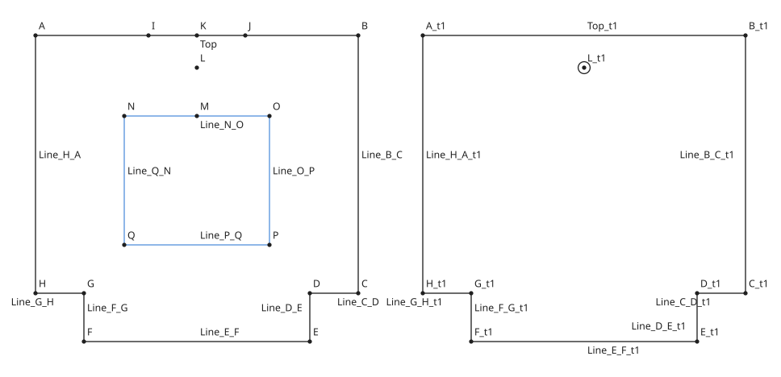
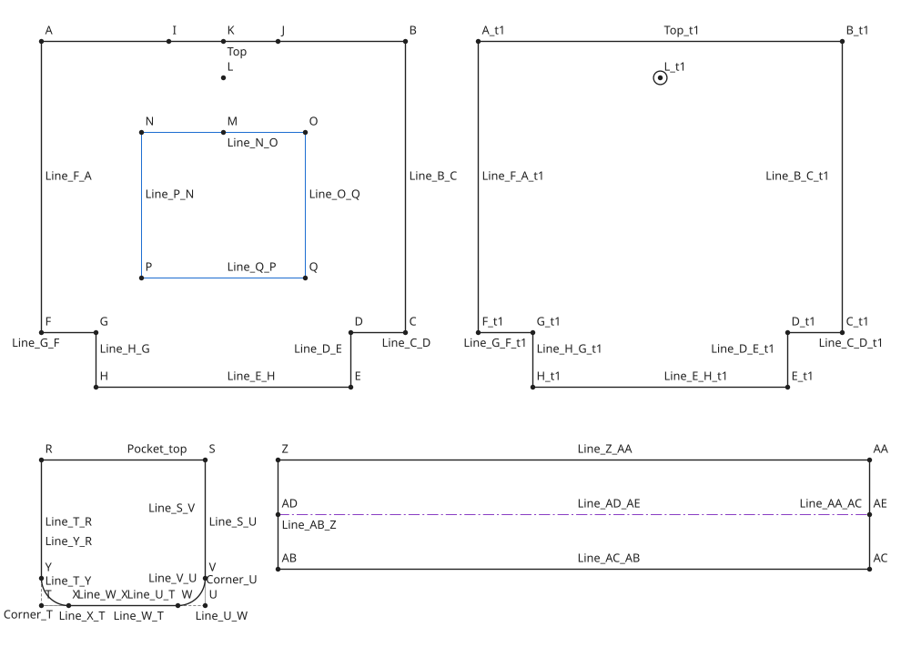
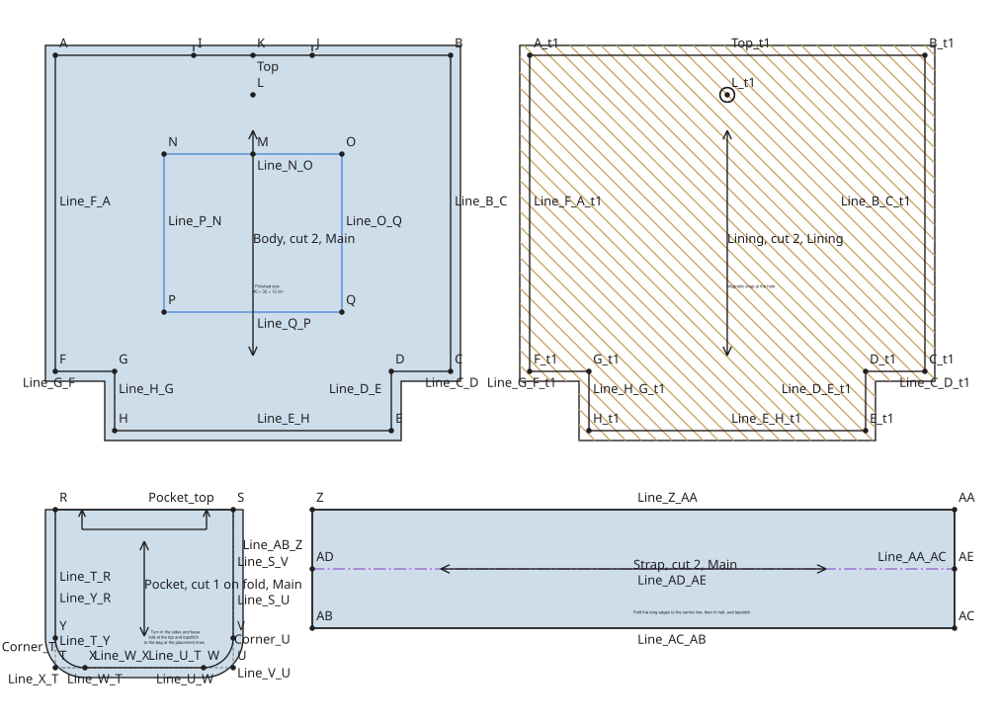

# A tote bag

This tutorial drafts a lined tote bag with boxed corners, a patch pocket and
two straps. It needs no measurements: the bag is sized by its variables, so
changing one number makes a bigger or smaller bag. On the way it covers
placement lines, a moved copy for the lining, rounded corners, materials, a
piece on the fold, seams and notes.

The finished pattern is in the documentation's examples:
[tote-bag.sloper](../examples/tote-bag/tote-bag.sloper). Open it at any point
to compare. Do the [straight skirt block](skirt-block.md) first if you are new
to OpenSloper: this tutorial goes faster over the same steps.

!!! note "Units"

    This tutorial works in centimetres. Before you start, set Edit →
    Preferences → Unit to Centimetres, so the new pattern is in cm.

!!! tip "Point names"

    The app names each new point with the next free letter. Make the points
    in the order the tutorial gives and their names match the text. Lines and
    curves are named after their ends, such as `Line_B_C`.

## 1. Variables

Start a new pattern (File → New) and save it as `tote-bag.sloper`.

The bag's sizes are variables. Save
[tote-bag.sloper](../examples/tote-bag/tote-bag.sloper) somewhere else, click
Import… in the Variables tab and choose it. These are added:

| Name | Formula | What it is |
| --- | --- | --- |
| `width` | `40` | Width of the bag at the top |
| `height` | `38` | Height of a body piece, before the corners are boxed |
| `gusset` | `12` | Depth of the boxed base; each corner cut-out is half of it square |
| `pocket_width` | `18` | Width of the patch pocket |
| `pocket_height` | `16` | Height of the finished pocket |
| `strap_length` | `65` | Length of each strap |
| `strap_width` | `3` | Finished width of each strap, cut four times as wide |
| `handle_gap` | `12` | Distance between the ends of a strap on the bag |

## 2. The body

The body is a rectangle with a square cut from each bottom corner. Sewn, each
cut-out's two sides are stitched together, which squares off the base: the
boxed corner.

1. With the Point tool (++p++), click to make **A**, the top left, and set
   X and Y to `0`.
2. Click level with A, about 40 cm to its right, for **B**. Click the wand
   button, **f**, at the right of its Length and choose `#width`.
3. Click below B for **C**, Length `#height - #gusset / 2`: where the right
   cut-out starts.
4. Click left of C for **D**, about 6 cm, and take `#gusset / 2` from the
   wand.
5. Click below D for **E**, Length `#gusset / 2`: the base.
6. Click below A for **F**, Length `#height - #gusset / 2`, then right of F
   for **G**, Length `#gusset / 2`, and below G for **H**, Length
   `#gusset / 2`.

With the Line tool (++l++), draw round the body as outlines: A to B, B to C,
C to D, D to E, E to H, H to G, G to F and F to A. Select the line from A to
B and name it **Top** in the properties: later steps measure along it.

{ .draft }

## 3. Marks on the body

The straps are stitched to the top either side of the middle, a magnetic snap
goes in the middle, and the pocket is sewn on below it.

With the Point tool, click on Top:

| Point | Click | Distance or ratio |
| --- | --- | --- |
| I | nearer A | `(#width - #handle_gap) / 2` |
| J | nearer B | `(#width - #handle_gap) / 2` |
| K | a little left of the middle, so it is measured from A | `#width / 2` |

I and J are where the straps' ends go. K is the middle of the top. Click below
K for **L**, Length `4`: the snap. Then click further below K for **M**,
Length `10`: the top of the pocket, in the middle.

The pocket's outline on the body is a placement line, which prints on the piece
to show where the pocket goes. Make its corners:

| Point | Made | Length |
| --- | --- | --- |
| N | Left of M | `#pocket_width / 2` |
| O | Right of M | `#pocket_width / 2` |
| P | Below N | `#pocket_height` |
| Q | Below O | `#pocket_height` |

Choose Tools → Draw As → Placement, then draw N to O, O to Q, Q to P and P to
N. Choose Draw As → Outline again before the next step.

{ .draft }

## 4. The lining

The lining is the same shape as the body. Rather than draw it again, make a
moved copy, which follows the body when a variable changes.

1. With the Select tool, click Top, then hold ++shift++ and click the body's
   seven other outline edges and point L. The copy takes the edges' end points
   with them.
2. Choose Tools → Transform → Move Copy…. The copies appear beside the body,
   named after their sources with `_t1`, such as `Top_t1` and `L_t1`.
3. In the transform's properties, set **Across** to `#width + 8` and
   **Down** to `0`.

The lining has the snap's other half, so mark it: select `L_t1` and choose
Hole as its Marker, with Size `1.5`.

{ .draft }

## 5. The pocket and the strap

The pocket is cut on the fold at its top, so it opens out to twice its
height, with its two bottom corners rounded.

1. Click below A, below the body, for **R**, Length `#height + 8`.
2. Click right of R for **S**, Length `#pocket_width`, then below R for
   **T** and below S for **U**, each with Length `#pocket_height`.
3. Draw R to S, S to U, U to T and T to R. Name the line from R to S
   **Pocket_top**.
4. Select `Line_S_U` and `Line_U_T` and choose Tools → Edge → Round Corner.
   An arc, `Corner_U`, replaces the corner, with points **V** and **W** where
   it meets the edges. Set its Radius to `3`.
5. Do the same at T with `Line_W_T` and `Line_T_R`, which makes
   `Corner_T` and points **X** and **Y**. Set its Radius to `3` too.

The strap is a long strip, cut four times its finished width, folded in to the
middle and in half again:

1. Click right of S for **Z**, Length `8`, then right of Z for **AA**, Length
   `#strap_length`. After Z the app goes on to two letters.
2. Click below Z for **AB** and below AA for **AC**, each with Length
   `#strap_width * 4`.
3. Draw Z to AA, AA to AC, AC to AB and AB to Z.
4. Click on `Line_AB_Z` just above its middle for **AD**, and on
   `Line_AA_AC` just above its middle for **AE**, each with Distance or ratio
   `#strap_width * 2`: they are measured from Z and AA.
5. Choose Draw As → Fold, draw AD to AE, and go back to Outline.

{ .draft }

## 6. Materials and pieces

The bag is cut from canvas, and the lining from a lighter cotton. In the
Materials tab, click Edit…:

- Select **Main** and choose Canvas as its fabric, for draping.
- Click New for a second material. Name it **Lining**, colour `#C9A66B`, fill
  Hatch, fabric Cotton.

With the Piece tool (++k++), click inside the body, the lining, the pocket and
the strap, and name them **Body**, **Lining**, **Pocket** and **Strap**. Each
starts with a 1 cm seam allowance. Then, in each piece's properties:

| Piece | Set |
| --- | --- |
| Body | Cut `2` |
| Lining | Cut `2`, Material Lining |
| Pocket | Fold: Pocket_top. Its label reads *Pocket, cut 1 on fold* |
| Strap | Cut `2`, Allowance `0`, Grainline angle `0`, along the strap |

The placement lines inside the body and the fold line down the strap become
the pieces' markings by themselves, and the hole marks the lining. With the
Notch tool (++t++), click on I and on J on the body's top, so the straps'
ends are marked on the cutting line.

## 7. Seams

Seams say which edges are sewn together, so the app checks their lengths and
the [drape app](../drape/index.md) knows what to sew. With the Seam tool
(++e++), click side A, press ++tab++, click side B, press ++enter++, and name
each seam in the Objects tab:

| Seam | Side A | Side B |
| --- | --- | --- |
| Sides | `Line_F_A` | `Line_B_C` |
| Base_seam | `Line_E_H` | `Line_E_H` |
| Corner_left | `Line_H_G` | `Line_G_F` |
| Corner_right | `Line_C_D` | `Line_D_E` |
| Top_seam | `Top` | `Top_t1` |

The two body pieces are sewn to each other at the sides and base, so each
edge is sewn to its copy on the other piece. The corners are each sewn across,
and the top of the bag is sewn to the top of the lining. Make the lining's
own seams the same way, from its copies: **Lining_sides**,
**Lining_base**, **Lining_corner_left** and **Lining_corner_right**.

Every seam's sides match, so the status bar shows no problems.

## 8. Notes

With the Text tool (++x++), click inside each piece and type its note. Each
hangs from its piece and prints with it:

| Piece | Note |
| --- | --- |
| Body | `Finished size` and, on the next line, `{=#width} × {=#height - #gusset / 2} × {=#gusset} cm` |
| Lining | `Magnetic snap at the hole` |
| Pocket | `Turn in the sides and base,`, `fold at the top and topstitch` and `to the bag at the placement lines`, on three lines |
| Strap | `Fold the long edges to the centre line, then in half, and topstitch` |

The `{= }` parts are worked out from the pattern, so the body's note reads
*40 × 32 × 12 cm* and follows the variables.

{ .draft }

## What next

- Change `width`, `height` or `gusset` and watch every piece, the pocket's
  place and the finished size follow.
- Open File → Publish… to lay the pieces out on the canvas and the lining,
  and print them.
- Open File → Drape… to see the bag sewn up: the example's drape file, beside
  the pattern, has the pieces placed already.
- Read [Shaping](../design/shaping.md) for more on transforms and rounded
  corners, and [Pieces](../design/pieces.md) for folds and seams.
